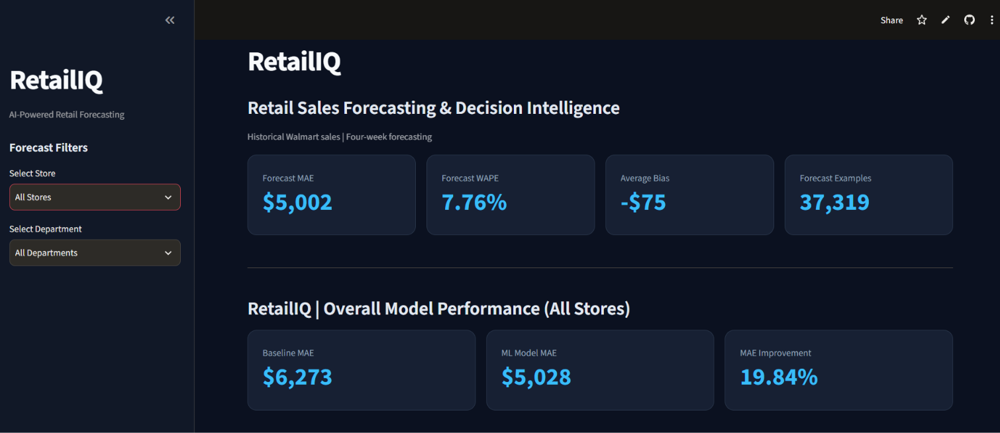

# RetailIQ
### AI-Powered Retail Sales Forecasting & Decision Intelligence

[🚀 Live Dashboard](https://retailiq-avni.streamlit.app) | [GitHub Repository](https://github.com/Avnisharma28/RetailIQ)

RetailIQ is an end-to-end retail analytics and machine learning project that forecasts weekly department-level sales and translates predictions into actionable business insights.

Built using historical Walmart sales data, RetailIQ combines predictive modeling, interactive analytics, forecast risk monitoring, and scenario simulation in a Streamlit dashboard.

## Dashboard Preview



[Explore the Live Dashboard](https://retailiq-avni.streamlit.app)


## Business Problem

Retail businesses need reliable demand forecasts to support inventory planning, resource allocation, and operational decisions.

Inaccurate forecasts can contribute to excess inventory, stockouts, and inefficient planning.

RetailIQ explores how machine learning can improve sales forecasting and help analysts identify locations where forecast uncertainty requires attention.

## Key Features

- **Four-Week Sales Forecasting:** Predicts future weekly sales at the store-department level.
- **Interactive Dashboard:** Filters forecasting results by store and department.
- **Model Performance Monitoring:** Compares machine learning predictions with a baseline forecast.
- **Business Insights:** Displays forecast accuracy, bias, and potential areas for investigation.
- **Store Risk Monitor:** Identifies stores with relatively high historical forecast errors.
- **Scenario Simulator:** Explores hypothetical changes in forecasted demand.
- **Forecast Diagnostics:** Visualizes actual versus predicted sales and error distributions.

## Dataset

**Source:** Walmart Recruiting - Store Sales Forecasting (Kaggle)

The historical dataset covers February 2010 through October 2012 and includes:

- 421,570 training records
- 45 Walmart stores
- 81 department identifiers
- Weekly sales observations
- Holiday indicators
- Store characteristics
- Economic and promotional features

The dataset is historical and is used for model development and retrospective evaluation, not live Walmart forecasting.

## Technology Stack

| Category | Technologies |
|---|---|
| Programming | Python |
| Data Processing | Pandas, NumPy, PyArrow |
| Machine Learning | Scikit-learn, XGBoost |
| Visualization | Plotly, Matplotlib |
| Dashboard | Streamlit |
| Model Storage | Joblib |
| Development | VS Code, Git |

## Forecasting Approach

1. Prepare and merge historical sales, store, and external-feature datasets.
2. Explore sales patterns, seasonality, and store-level differences.
3. Engineer forecasting features.
4. Train and compare baseline and machine learning models.
5. Evaluate forecasts using historical validation periods.
6. Generate four-week forecasting results.
7. Present forecasts, diagnostics, and business insights in Streamlit.


## Model Performance

RetailIQ evaluates four-week-ahead sales forecasts using historical Walmart sales data. The machine learning model was compared against a baseline forecasting approach using the same historical validation observations.

| Metric | Result |
|---|---|
| Baseline MAE | $6,273 |
| Machine Learning MAE | $5,028 |
| MAE Improvement | **19.84%** |

The machine learning model achieved a **19.84% reduction in Mean Absolute Error (MAE)** compared with the baseline, reducing average absolute forecasting error by approximately **$1,245 per evaluated forecast**.

This improvement indicates that the machine learning model produced more accurate sales predictions than the baseline on the evaluated historical data.

The dashboard also provides additional performance metrics:

- **WAPE (Weighted Absolute Percentage Error):** Measures forecasting error relative to actual sales volume.
- **Average Signed Error (Bias):** Helps identify systematic overforecasting or underforecasting.
- **Store-Level Performance:** Highlights differences in forecasting accuracy across Walmart stores.

**Note:** These results are based on historical backtesting rather than live forecasting. Model performance may vary across stores, departments, and future periods.


## Dashboard

The RetailIQ dashboard includes:

- Executive forecasting KPIs
- Baseline versus machine learning performance
- Forecast accuracy and bias insights
- Actual versus predicted sales charts
- Store-level performance comparisons
- Forecast risk monitoring
- Interactive demand scenario simulation
- Detailed forecast records

The scenario simulator applies hypothetical proportional adjustments to existing forecasts. It does not retrain the model or estimate causal effects.

## Run Locally

Clone the repository and navigate to the project folder.

Create a virtual environment:

```bash
python -m venv .venv
```

Activate it on Windows:

```powershell
.\.venv\Scripts\Activate.ps1
```

Install dependencies:

```bash
pip install -r requirements.txt
```

Launch the dashboard:

```bash
streamlit run app/dashboard.py
```

Open the local URL displayed in the terminal, usually:

http://localhost:8501

**Note:** The dashboard requires the generated forecasting output files. Run the data preparation and forecasting pipeline first if those files are not included in the repository.

## Project Structure

```text
RetailIQ/
├── app/
│   └── dashboard.py
├── Data/
│   ├── Raw/
│   └── processed/
├── models/
├── reports/
├── src/
│   ├── prepare_data.py
│   ├── explore_data.py
│   ├── feature_engineering.py
│   ├── train_model.py
│   ├── improve_model.py
│   ├── train_4week_model.py
│   ├── build_forecast_dataset.py
│   └── analyze_forecasts.py
├── requirements.txt
├── .gitignore
└── README.md
```

## Business Value

RetailIQ demonstrates how predictive analytics can support retail decision-making by:

- Improving forecast accuracy relative to a historical baseline.
- Identifying stores with elevated forecasting errors.
- Highlighting systematic overforecasting or underforecasting.
- Supporting exploratory demand planning through scenario analysis.
- Making model outputs accessible through an interactive interface.

## Limitations

- Historical data from 2010-2012 may not represent current retail conditions.
- Forecast risk categories use illustrative thresholds rather than validated operational risk estimates.
- Scenario adjustments are hypothetical and should not be interpreted as causal predictions.
- Model accuracy may vary by store, department, and forecasting period.

## Future Improvements

- Additional rolling-origin backtesting
- Forecast uncertainty intervals
- Stronger seasonal baseline comparisons
- Automated model monitoring
- More advanced demand scenario modeling
- Improved inventory planning recommendations

---

**RetailIQ | Retail Forecasting, Machine Learning & Business Intelligence**
